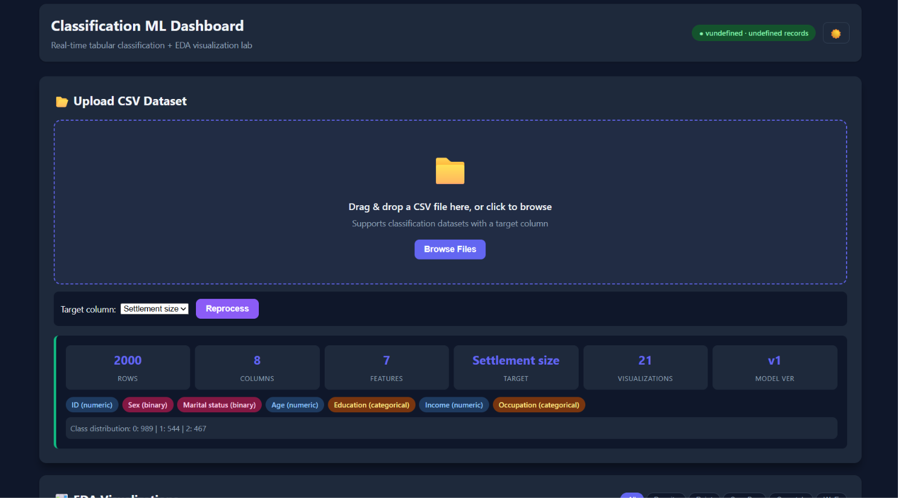
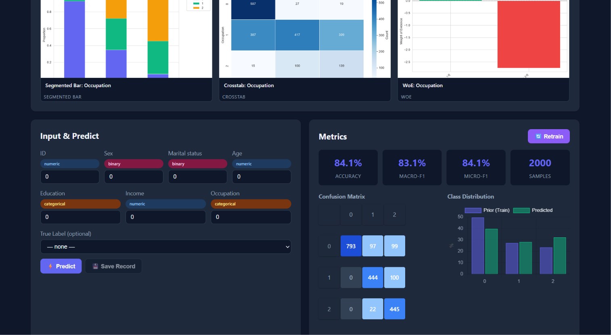

<div align="center">

# 📊 Classification ML Dashboard

**A real-time classification ML dashboard with auto-EDA visualization. Upload a CSV → instant predictions → live metrics → 5 types of EDA plots generated automatically.**

[](https://www.python.org/)
[](https://fastapi.tiangolo.com/)
[](https://scikit-learn.org/)
[](LICENSE)

</div>

---

## Why this exists

Most ML dashboards require you to write code for every visualization. This one **auto-detects** feature types from your CSV and generates the right EDA plots automatically   segmented bars for categoricals, density plots for numerics, WoE for all features. No configuration needed.

It's also a **live ML lab**: input data → instant prediction → data accumulates → metrics & confusion matrix update in real-time → retrain on accumulated data.

## What it does

- **CSV Upload**  drag & drop any classification CSV. Auto-detects feature types (numeric/categorical/binary) and target column.
- **Auto-Visualization**   generates 5 types of EDA plots automatically:
  - **Overlapping Density**   KDE/histogram by class (numeric features)
  - **Point Plot**   mean ± CI per class (numeric features)
  - **Segmented Bar**   class proportion per category (categorical features)
  - **Crosstab Heatmap**   feature × target count matrix
  - **WoE (Weight of Evidence)**   with IV annotation (all features)
- **Real-time Prediction**   input features → instant class + probability bars
- **Live Metrics**   Accuracy, Macro-F1, Micro-F1 update every 5s
- **Confusion Matrix**   auto-updating heatmap
- **Retrain**   one-click model retraining on accumulated labeled data
- **Dark Mode**   toggle with persistence

## Architecture

```
classification-dashboard/
├── backend/
│   ├── app.py              # FastAPI routes + static serving
│   ├── database.py         # SQLite accumulating store
│   ├── model.py            # ML model (train/predict/metrics/CM)
│   ├── schemas.py          # Pydantic models
│   ├── visualizations.py   # 5 plot generators + auto-detection
│   └── requirements.txt
├── frontend/
│   ├── index.html          # Dashboard (upload + viz gallery + predict + metrics)
│   ├── styles.css          # Clean modern styling + dark mode
│   └── app.js              # Real-time interactions + Chart.js
└── README.md
```

## Preview





```bash
cd classification-dashboard/backend
pip install -r requirements.txt
uvicorn app:app --reload --port 8000
```

Open http://localhost:8000 → drag & drop a CSV → watch the magic.

## API Endpoints

| Method | Path | Description |
|---|---|---|
| GET | / | Dashboard UI |
| POST | /upload-csv | Upload CSV, analyze, train, generate viz |
| GET | /csv-info | Upload metadata |
| GET | /visualizations | List generated viz (base64 images) |
| POST | /predict | Real-time prediction |
| POST | /data | Save record (auto-predict) |
| GET | /data | List records |
| GET | /metrics | Model metrics |
| GET | /confusion-matrix | Confusion matrix |
| POST | /retrain | Retrain on labeled data |
| GET | /distribution | Class distribution |
| DELETE | /csv | Clear all data |
| GET | /health | Health check |

## ML Details

- **Model**: RandomForest with class weight (capped at 3.0 per best practices)
- **CV**: StratifiedKFold 5-fold, macro-F1 primary metric
- **Metrics**: Accuracy, Macro-F1, Micro-F1, per-class precision/recall/F1
- **Storage**: SQLite (single file, no external DB)
- **Viz**: matplotlib Agg → base64 PNG (server-side rendering)

## Tech Stack

**Backend:** FastAPI · scikit-learn · pandas · matplotlib · seaborn · SQLite · Pydantic

**Frontend:** Vanilla HTML/CSS/JS · Chart.js (CDN)

**No build step required.**

## License

[MIT](LICENSE)
